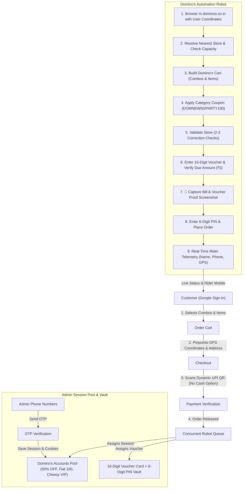

# DominoSync | Autonomous Domino's India Ordering Engine

Complete automated Domino's pizza delivery platform with **Customer Storefront**, **Dynamic UPI QR Code Payment**, **Admin OTP Session Pool**, **Autonomous Domino's Ordering Robot**, and **16-Digit Voucher / 6-Digit PIN Settlement**.

---

## 🌟 Key Architecture & Mechanism



---

## 🚀 How to Start the Engine

Navigate to the project directory and start the server:

```powershell
cd C:\Users\parth\.gemini\antigravity\scratch\dominos-automation-platform
node server/index.js
```

### Access URLs:
* **Customer Storefront**: `http://localhost:3000`
* **Admin Management Console**: `http://localhost:3000/admin`

---

## 📁 System Breakdown

* `server/index.js`: High-performance HTTP server & REST APIs (Zero external npm dependencies needed).
* `server/db.js`: Atomic database managing Accounts, Vouchers, Combos, Menu, and Orders.
* `server/dominosWorker.js`: Core autonomous Domino's robot that handles store discovery, cart building, coupon application, address injection, 16-digit voucher card entry, proof photo capture, 6-digit PIN verification, and live rider tracking.
* `server/adminSession.js`: Admin OTP service that authenticates Domino's accounts and preserves session tokens and cookies.
* `server/queue.js`: Concurrent queue processing multiple simultaneous orders.
* `server/screenshotHelper.js`: Captures SVG bill screenshots showing store stamp, itemized bill, voucher applied state, and ₹0 due amount.
* `public/index.html` & `public/app.js`: Customer storefront featuring Google Sign-in identity, Combos catalog, GPS coordinate lock, Dynamic UPI QR payment modal, and live tracking pipeline.
* `public/admin.html` & `public/admin.js`: Admin portal for managing Domino's account pool by discount categories, 16-digit voucher inventory, and real-time robot orders monitor.
